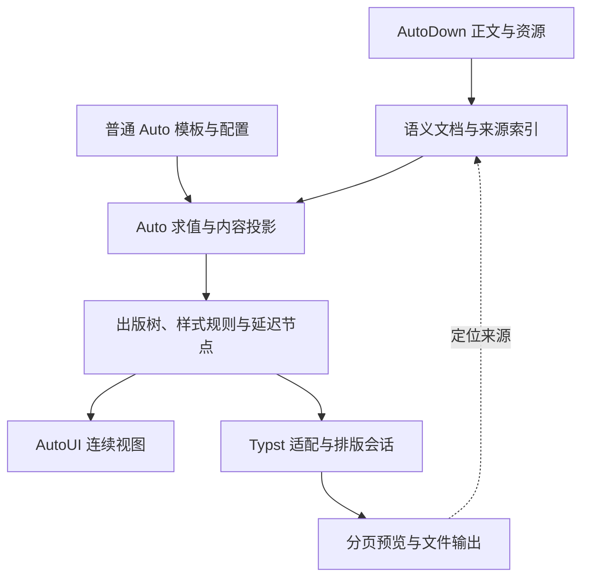

# 10 AutoDown 文档排版与 Auto 模板设计

> 状态：Draft 0.1 / 原型优先；不是已实现能力或冻结语法。
> 日期：2026-11-14（Asia/Shanghai）。
> 目标版本：v0.6 文档排版方向；原型反馈可以修改 API、语法糖和内部表示。
> 2026-11-20 更新。082 原型与 083 样式系统已交付，084–086 按新版优先修订。已交付合同见 [出版原型规范](../specs/publishing.md)。

## 1. 决策与目标

正文用 Auto Node 表达，即 AutoDown；Markdown 是常见内容节点的语法糖。模板用普通 Auto 脚本，复用 fn、type、控制流、模块和包机制。模板接收内容和参数，生成内容、样式作用域、呈现规则及延迟布局节点。文档库与排版运行时提供专业能力，首个后端采用 Typst。

不另造一门模板脚本语言。现有 style recipe 是起点，后续向结构化 Style 值及返回 Style 的普通函数发展，避免长期维护平行的参数替换与表达式解释器。

整体名称暂用“AutoDown 排版系统”；AutoStyle 是与 AutoUI 共用的样式基础的候选称呼，文档模块可使用 auto.down.style。文档模板与内容投影不统称为 style。包名与导入路径在原型后按现有包工具核验。

### 1.1 用户目标

- 一份正文配合不同模板，输出论文、办公风格书籍、出版风格书籍、基础报纸和演示文稿。
- 修改内容、模板或参数，获得实时分页预览；预览与文件输出采用相同排版配置。
- 作者能用普通 Auto 函数开发模板，自定义语义节点并复用 AutoUI 的样式基础。
- 内容 ID、来源、引用和知识关系跨视图保持，支持点击定位、批注和 AI 工具操作。
- 先做小原型检验效果；常用写法简洁，底层表示可检查，后续可替换后端。

### 1.2 输出形态与格式分开

| 维度 | 示例 | 作用 |
| --- | --- | --- |
| 内容视图 view | article、book、newspaper、slides | 选择并组织内容 |
| 模板 template | academic、office_book、press_book、news、lecture | 页面结构、样式与呈现 |
| 布局 layout | flow、paged、slides | 连续流、分页或幻灯片 |
| 后端 backend | autoui、typst | 执行布局与渲染 |
| 文件格式 format | pdf、svg、png | 序列化输出结果 |

“Word 风格”是视觉与结构目标，不等于可编辑 DOCX；“PPT 式演示”首期可用 PDF 幻灯片，不等于可编辑 PPTX。DOCX、PPTX 后续从语义与出版树设计独立适配，不能通过改扩展名或把整页图片包装进去宣称可编辑等价。

## 2. 现有基础与实际差额

以下为 2026-11-14 的只读源码观察；历史计划的通过数字不作为当前测试结果。

| 基础 | 当前观察 | 本设计的扩展 |
| --- | --- | --- |
| AutoDown 内核 | [block_model.at](../../autodown/packages/engine/auto/parser/block_model.at) 有 BlockNode、ID、SourceRange、属性与子树；BlockType 是固定枚举 | 保留现有解析/编辑合同，增加文档语义与扩展节点适配 |
| 统一引擎 | [Design 09](09-unified-document-engine.md) 定义共享语义内核、屏幕渲染与编辑分层 | 增加专业排版投影；同一布局模式的编辑/展示仍共用布局结果 |
| style 声明 | auto-ui 的 StyleRecipeDecl 有参数、表达式体和导出标记 | 函数式调用沿用，补结构化值与文档样式检查 |
| recipe 引擎 | auto-ui 的 recipe.rs 有默认实参、命名/位置参数、组合、展开、导入与循环检查 | 现有 class 路径不等于完整文档样式，也不能据 Expr 字段推定支持任意函数体 |
| 参数类型 | AST 保存类型；recipe 调用检查主要是名称、数量和必填项 | 新接口复用 Auto 的通用类型检查，不能把已能写 str 当作完整类型安全证明 |

独立 UI 仓源码定位（与本仓同级时）：

- [声明 AST](../../../auto-ui/crates/auto-ui-dialect/src/ast.rs)
- [现有配方实现](../../../auto-ui/crates/auto-ui-compiler/src/design_tokens/recipe.rs)
- [现有测试](../../../auto-ui/crates/auto-ui-compiler/tests/design_tokens_recipe.rs)
- [stylekit](../../../auto-ui/examples/ui/stylekit/src/front/styles.at)

本设计不把 AutoUI 或 AutoLang 中尚未实施的能力标成已实现，不以新增文档改变现有四个 engine 出口的冻结合同。

## 3. 架构与数据流



建议的职责边界：

| 层 | 所有者/职责 | 禁止混入的职责 |
| --- | --- | --- |
| 语言求值 | AutoLang/ACE 的表达式、函数、类型、模块 | AutoDown 自写一套 fn/if 解释器 |
| 文档内核 | AutoDown 的内容、ID、来源、选择与操作 | DOM、具体字体引擎和 Typst 内部结构 |
| 文档库 | Content、Style、规则、引用、延迟 API、模板包 | 隐式修改原始正文 |
| 出版适配 | 版本化出版 IR、资源、诊断、后端能力协商 | 将任意普通字符串当可执行 Typst 源码 |
| 排版会话 | Typst 初期负责测量、断行、分页和上下文 | AutoUI 另算分页后声称与输出一致 |
| 交互壳 | AutoUI 编辑、模板参数面板、预览、定位 | 直接修改已排版字形作为持久文档编辑 |

### 3.1 后续执行端与预览端

082/083 的既有原型提供对照基线。后续模板优先使用 ACE AV 开发和验证，同时以新版 A2R 生成的实际可执行文件验证同源模板。084 首先对现有 `main.at` 和真实输入验证，检查成功 IR 与失败诊断。采用哪条路径以该用例的实际结果为准。

Typst 负责测量、断行、分页和导出。085 优先用新版 AutoUI/AGE 在 Windows 验证直接窗口预览，将 Typst 页面和位置映射接到显示及事件接口。发布会话与 revision、页面、诊断及来源映射保持在适配边界，RQ 和新版 A2R GUI 可按真实消费需求接入。086 优先用 ACE 的受检表示生成布局 IR，再由 Typst 执行布局。

若新版具体接口暂缺，可显式复用经验证的旧版适配器，保留同一模板逻辑、出版 IR 与预览会话接口。记录实际引擎、最小复现、负责方和新版切换条件。不同执行端单列结果。排版工作按实际接口推进，无须等待 ACE M2/B、AGE M2 或新的正文方言整体交付。

## 4. 内容模型：同一语言，两类使用方式

### 4.1 Content 是一等值

概念合同如下，名称与具体泛型写法均可随原型调整：

| 值 | 含义 |
| --- | --- |
| InlineContent / BlockContent | 可组合的行内/块内容，不能混入不合法容器 |
| Content | 内容序列或子树；可传参、返回、拼接与复用 |
| SemanticDocument | 元数据、正文、资源、语义 ID 与源位置 |
| Publication | 模板与视图展开后的出版树、规则、延迟节点 |
| Style / StyleRule | 带类型的属性值与有作用域的规则 |
| LayoutContent | 需要布局上下文才能求值的内容 |

Content 优先使用不可变值和结构共享。模板函数创建新出版树，编辑通过语义内核事务修改原文。模板产物和分页结果均不回写进正文来充当新的真相源。

Node 是统一构造形式，但并非所有 Node 在所有位置都合法；schema 与领域检查决定允许的父子关系。语义节点、样式节点、布局节点使用可扩展注册与适配，不要求把整个系统塞入一个不断膨胀的枚举或通用动态 Value。

### 4.2 正文格式边界

- .ad 的 Markdown、已有扩展和在途书籍格式由格式规范所有者统一定义；本设计不发明第二套 card、段落 ID 或代码嵌入分隔符。
- 正文中的 Markdown 标题最终规范化成 heading(level, body)，保留原始拼写与来源，避免 h2 和 heading 成为互相独立的语义类型。
- 显式 Node 片段复用 Auto 语法解析能力；原型若只支持一个节点子集，必须列出白名单和诊断。
- 普通代码展示节点默认是内容。执行 Auto 生成内容必须经明确的文档执行入口，不能把任意代码围栏和插值文本自动执行。
- 现有 frontmatter 可以适配为 document metadata；保留未知字段与 roundtrip 信息。正式变更前不默认为 parser 已支持全部元数据。
- Content 与 str 分离。text(str) 插入文本，parse_document(str) 才解析 AutoDown；普通文本的引号、井号等必须保持字面含义。

以下纯 Node 示例是目标表示，不是当前 parser 验收样例：

```auto
document {
    metadata { title: "相机与激光雷达融合研究" }
    body {
        h1 { id: "method"; "方法" }
        p { id: "method-overview"; "本文介绍一种多传感器融合方法。" }
        theorem {
            id: "consistency"
            title: "一致性条件"
            body { p { "各传感器应具有可对齐的时间与空间基准。" } }
        }
        ref { target: "consistency" }
    }
}
```

### 4.3 ID、来源与复用

- NodeId 标识语义内容；显式作者 ID 优先，自动 ID 沿用内核稳定策略，不能随每次排版随机重建。
- OccurrenceId 标识某个内容在某个出版视图中的一次出现；同一 Content 使用两次有两个 occurrence。
- Origin 包含文档/模板 URI、源范围、来源 NodeId，以及必要的模板调用来源。合成节点也要区分正文来源和模板来源。
- 引用默认指向语义 ID，在选定视图内解析为明确 occurrence。出现多个候选时报告歧义，允许显式选择；不悄悄指向第一个复制件。
- 原型只保证块级来源定位；字符定位、生成内容的多来源映射与正式编辑联动按阶段验收。
- 自定义节点未注册时仍应保留原始表示和 ID；屏幕可显示占位，发布时按能力策略报告或使用显式 fallback。

## 5. 模板：普通 Auto 函数

模板的概念签名为 Template(DocumentInput, Options) -> Publication。简单模板可用 Content -> Content；复杂模板接收元数据、命名插槽与资源描述。type 校验参数，fn 复用逻辑，if/for/map 生成内容，use/pac 复用模块与包。

下列及后续 Auto 代码全部是 API 草案，不能用文档中的声明代替编译器探针：

```auto
type BookOptions {
    title str
    authors List<str>
}

fn cover(options BookOptions) Content {
    return page {
        heading { options.title }
        for author in options.authors {
            p { author }
        }
    }
}

fn book(body Content, options BookOptions) Content {
    return document {
        cover(options)
        outline {}
        content { value: body }
    }
}
```

插槽使用普通命名参数或 SlotMap 表达 title、abstract、body、bibliography、appendix 等，提供必填、可选、默认值和允许类型。正文插入次数可校验，避免误漏正文；允许多次插入时由调用方承担 occurrence 与引用策略。

模板参数 schema 同时供 Auto 类型检查和 AutoUI 面板使用，但面板只展示适合交互的字段；函数、资源句柄等不强行转成表单。用户修改面板参数触发新出版 revision。

模板分为可组合的函数/数据模块，提供 base + options 的派生方式；不引入固定层级的模板继承体系。编译后的不可序列化闭包不直接塞入跨进程 IR；跨边界前展开或转换成后端支持的表达式。

## 6. 样式、默认值与作用域

### 6.1 style 的演进

现有字符串 class recipe 保持兼容。文档侧新增有类型的 Style 数据；参数化 style 的目标是复用普通函数求值后产生 Style，具体语法在原型中比较。

```auto
// 目标形态，待语言与 UI owner 探针核验
style body_text(size: Length = 11.pt) = text_style {
    font: ["Noto Serif CJK SC", "Libertinus Serif"]
    size: size
    lang: "zh"
}
```

若暂时不能复用 style 声明，原型直接使用普通 fn 返回 Style 或普通类型化对象；这不影响验证模板架构。禁止为通过原型而新建一个只支持字符串拼接的文档样式解释器。

### 6.2 公共属性与文档扩展

与 AutoUI 共享颜色、字体、边框、间距、对齐和语义 token 的概念与类型。文档增加段落、编号、分页、浮动、页眉页脚等属性族。共享 schema 不意味着共享布局算法。

Length 区分绝对 pt/mm/in 与相对 em/百分比/可分配份额；数值与单位不能只靠任意 class 串承载。相对值在指定上下文解析。UI 的逻辑 px/dp 映射需要显式策略，不默认为印刷物理尺寸。

属性必须声明适用节点、默认值、是否继承、允许值与后端能力。文本继承字体和颜色；页面尺寸、分页约束不以文本继承规则处理。媒体与输出模式是显式参数，不读取进程全局主题来决定出版物最终样式。

### 6.3 覆盖与延后应用

按属性逐项合成，优先级从低到高：内置默认、主题、模板、文档规则、节点显式属性。继承属性先获得父节点的计算值作为基值，再应用当前节点规则。

同一层按作用域深度、声明顺序确定覆盖；更内层优先，同深度后声明优先。首期不引入 CSS specificity 和 important。selector 更具体不自动获得额外权重。

styled/scope 节点中的规则覆盖其整个内容子树，离开该子树即恢复。这是本方案的明确语义，不声称与 Typst “从声明处影响后续内容”的所有顺序细节逐项相同。

Content 即使先构造、后传给模板，模板作用域的默认样式仍应在发布/布局时生效。不能在创建 text 节点时把全部默认值固化成显式属性，否则模板无法修改它。

### 6.4 完整表示与简写

完整规则可序列化与检查：

```auto
rule {
    select: heading.where(level: 1)
    style: text_style { size: 16.pt; weight: 700 }
}
```

常用写法可脱糖到相同表示：

```auto
styles {
    text { size: 11.pt }
    paragraph { justify: true }
    heading(level: 1) { size: 16.pt }
}
```

此处 styles 内的子节点是规则，不插入正文。属性名、selector 构造和分号写法尚可修改。utility class 可作为部分样式的简写；原始 CSS 保留为 Web 专用接口，不作为文档 IR 的唯一基础。

## 7. 选择器与呈现规则

### 7.1 选择器

选择器是一等值，首期覆盖语义类型、属性相等、ID、语义 role，以及 and/or 组合。后续按需补祖先/后代、文本/正则和范围选择；必须区分布局前可判断的条件与依赖位置的条件。

选择器用于样式、内容查询和呈现规则，统一字段语义。按对象类型选择不能依赖生成的 CSS class 或某个平台控件名。

### 7.2 呈现函数

RenderRule 的概念输入为匹配到的语义节点、计算样式与 RenderContext；输出 PresentationContent。普通 Auto fn 完成定理框、章节页、图题等结构构造。

原型每个 occurrence 选择优先级最高的一条呈现规则；使用 next/default renderer 显式委托下层规则，避免隐含多次包裹的难以预测行为。样式规则仍按第 6 节逐属性合成。

引擎记录 (rule, occurrence) 的活动应用，默认呈现或 next 不再次匹配同一条规则。新生成的普通子节点可以继续参与各自规则；产生新语义节点必须给稳定生成键并受展开预算约束。

视觉替换保留 semantic origin、role、label、编号和阅读顺序。把 heading 画成装饰文本，不得让目录失去这个标题；模板显式将其排除于目录是另一种可检查的语义操作。

## 8. 内容投影与输出视图

View(Document, ViewOptions) -> Content/Publication，负责选择与组织；Template 负责页面和呈现，两者可组合但职责不混淆。

- article/book 主要保留正文结构；不同模板改变标题区、章节组织、页面与引用样式。
- newspaper 以 article/story 为逻辑单元，首期验证多栏、跨栏标题、图文网格。任意文本框串文、复杂绕排、印前拼版不属于首个原型。
- slides 优先使用作者标注的摘要、结论、图表、slide 与 speaker_notes 等节点。普通函数可以按章节分镜；不承诺把任意长文自动变成优质演示。
- 文字精简与摘要属于显式编辑/AI 操作，不能在切换模板时隐式改写原文。
- 展开/折叠、动画与分步展示需要可重复的最终态/步骤映射。首期静态幻灯片只验证一个步骤；演示播放器与可编辑 PPTX 另行扩展。
- 屏幕交互图表可有 print fallback（静态矢量图、表格与说明），fallback 应由节点/模板声明并留诊断。

```auto
// 发布请求草案；实际 CLI 在原型包中定义
publish {
    source: "research.ad"
    view: slides
    template: lecture
    layout: slides
    backend: typst
    format: pdf
}
```

## 9. 求值阶段、布局上下文与副作用

### 9.1 阶段合同

| 阶段 | 输入与允许行为 | 产物 |
| --- | --- | --- |
| A 解析/资源解析 | 正文与模板源码、显式数据依赖 | 语义文档、模块与资源清单 |
| B 普通 Auto 求值 | 任意已支持的 fn/type/控制流；构造内容、视图与模板 | 出版树与未求值布局节点 |
| C 规范化/索引 | 合法性、样式规则、最终逻辑结构与引用目标 | 标准化出版树、逻辑文档索引 |
| D 排版求值 | 页面/容器尺寸、样式、位置、测量、计数器与查询 | 布局结果及上下文依赖 |
| E 呈现/输出 | 布局结果、来源映射与输出配置 | 页面、文件、诊断与交互映射 |

排版可重入 D 并产生位置相关的更新，不把 A/B 的读取外部数据、写文件等行为随每轮布局重复执行。B 阶段内容先求值仍不意味着样式默认值被提前固化。

### 9.2 延迟 API

目标 API 包括 contextual(fn)、layout(fn)、measure(content, constraints)、query(selector)、locate(target)、counter(...).at(location)。普通 Auto 回调接收只读上下文并返回内容；不是增加一套专用 if/for 语法。

```auto
fn footer(ctx LayoutContext) Content {
    return text { "第 {ctx.page_number} 页，共 {ctx.total_pages} 页" }
}

page {
    footer: contextual(footer)
}
```

上下文按每个 occurrence 和实际插入环境求值；同一个延迟内容在两页出现不能共用一个提前计算的结果。回调可能执行多次，不能依赖调用次数递增外部变量。布局回调限制可见副作用，所需外部数据在 A/B 阶段显式读取并冻结成输入。

LayoutContext 应提供样式、容器约束、定位与查询服务，而非一个无边界的全局对象。位置与总页数内部可以处于未稳定阶段；后端管理暂值、重算与诊断，用户不能把暂值误当作最终导出结果。

### 9.3 首个 Typst 后端如何接入普通 Auto 回调

一次性生成 .typ 再调用 CLI，不能让 Typst 自动执行任意 Auto 闭包。因此采用明确的两层能力：

1. 排版前模板使用普通 Auto 完整求值，生成版本化出版 IR。
2. 布局相关回调在通用 Auto 语义/类型检查后，将支持的纯表达式降为 LayoutExpr，再由适配器生成 Typst context/layout/query 等结构。

原型 LayoutExpr 至少覆盖常量、只读捕获值、上下文字段、长度/数值运算、比较、if、内容构造、内置计数器与引用；具体支持集由探针确定并公开。不能把任意回调源码直接 eval 成另一门脚本，也不承诺全部 Auto 库调用可进入 Typst 布局阶段。

不支持的布局回调给 E_LAYOUT_CALLBACK_UNSUPPORTED，定位到 Auto 源码并说明允许范围。后续可选宿主桥接或自研后端来执行更完整的 Auto 回调；是否修改 Typst 内核以支持宿主回调需独立技术验证，标准接口不视为已经提供此能力。

LayoutExpr 是后端边界上的数据 IR，不是给作者另造一门模板语言。初期若只能支持少数延迟内置节点，必须在报告中写明该差额，不能宣称任意上下文回调已经对齐。

## 10. 编号、引用、查询与稳定性

### 10.1 文档顺序

逻辑顺序取模板和视图展开后的出版树阅读顺序，不取 Auto 函数调用顺序，也不按视觉 x/y 排序。章节、图、表、公式等计数器有独立命名空间、作用域、重置与显示规则。

计数器更新表示为文档事件；在指定位置读取和 final() 是领域 API，不能用模板执行时的全局自增变量替代。模板插入前言、重复使用内容与章节重排均须有反例验证。

### 10.2 引用与查询

- ref/cite/footnote 是语义节点，带目标、用途和显示策略；后端生成编号、链接与必要的 supplement。
- 章节号、页码、图号分别查询，不把标签显示串当作目标标识。
- DocumentIndex 收集固定结构展开后的可引用语义 occurrence；普通查询返回稳定句柄而非可修改原文的对象。
- 页面位置查询在排版时解析；目录先知道有哪些标题，页码由后端延迟求值。
- 呈现函数生成的装饰默认不新增目录条目。延迟计算若生成可查询语义节点，需要显式稳定键与后端支持；首个原型可以拒绝这种动态结构。
- bibliography 以显式资源与引用键为输入，原型先验证一种数据格式及一种编号风格；完整 CSL/各期刊一致性须另测。

### 10.3 收敛与失败

样式、位置、查询可能形成反馈依赖。Typst 内部轮次与警告由适配器保留，不外套一个无界重试循环。宿主请求设时间/展开预算，并区分 pending、成功带警告和失败。

出现未收敛、悬空引用、重复标签时，预览保留上一个成功版本并显示新版本诊断；正式输出策略可配置，但默认不以旧 PDF 冒充本次成功。导出结果和预览结果必须绑定 revision 与诊断状态。

## 11. 排版元素、资源与格式适配

| 能力族 | 首轮目标 | 后续扩展 |
| --- | --- | --- |
| 文本/段落 | 中英文、字体回退、字号、缩进、对齐、基本断行 | 更完整的 CJK、标点挤压与语言细则 |
| 页面/书籍 | 纸张、页边距、单双栏、页码、页眉页脚、显式分页 | 奇偶页、装订边、复杂章节起始策略 |
| 图表 | 图片、caption、基本表格与显式宽度 | 跨页表格、重复表头、复杂浮动 |
| 数学 | 明确 dialect 的 Typst 公式 | TeX 子集转换及更完整数学语义层 |
| 学术结构 | 标题编号、目录、引用、脚注、一个文献样例 | 更复杂文献与期刊格式核验 |
| 演示 | 16:9、显式 slide、静态内容与分镜规则 | 分步展示、备注面板、播放器 |

公式节点保存 dialect 和原始源码。TeX/KaTeX 与 Typst 数学语法不能因为都出现美元符号而直接混用。不能转换的公式给定位诊断；矢量 fallback 是明确降级，不当作原生可编辑公式等价。

ResourceResolver 负责字体、图片、数据和包依赖。出版请求记录模板/引擎版本、资源内容哈希、字体集合、语言与输出配置。预览和导出复用同一清单；字体缺失或替代应可见。

普通文本、资源路径、ID 与 Typst 代码使用各自序列化入口。默认通过元素构造/字面量转义生成代码；原生 Typst 扩展是明确标记的后端专用接口，不能默认为跨后端内容。

## 12. Typst 适配与可替换性

### 12.1 边界数据

出版 IR 包含 schema_version、根内容、样式/呈现结果、延迟表达式、资源引用、origin 与所需能力。先选 JSON 便于观察，Atom/Batom 在边界稳定后替换或并存；不要直接序列化运行时闭包或 Rust 内部布局。

Session 输入为出版请求与资源；输出包括 revision、状态、页面尺寸与句柄、diagnostics、SourceMap 和可导出的布局结果。正式服务可用进程或窄 ABI，协议不强制与 UI 进程同存活。

后端声明支持的属性、节点和延迟能力。已支持项必须保持语义；不支持项选择 error、明确 fallback 或用户允许的 warning。禁止静默丢弃分页约束、脚注或章节结构。

### 12.2 原型路线

- P0/P1 可生成稳定的 Typst 源文件与映射表，再调用固定版本 CLI；这样可以直接检查中间结果。
- P2 切入持久会话/缓存；可以用 Rust World 实现或复用经过验证的现有预览部件。选择后记录版本与许可证。
- 初期无需重写 Typst 排版算法，也不要求将全部原生模板自动转译成 Auto。
- 允许显式包装现有 Typst 模板，但参数桥接必须声明，标记为 Typst 专用；通用 Auto 模板仍是主要方向。

替换后端的依据是出版语义合同与兼容测试，而非“都是 Node 所以自然相同”。自研排版、平台输出与可编辑 Office 格式需要各自能力与误差说明。

## 13. 实时预览、编辑与工具接口

### 13.1 会话与增量

每次正文、模板或参数变更产生新 revision。解析缓存、模板求值缓存、排版缓存、页面渲染缓存分别管理。缓存键包含实际依赖的源码、配置、字体、资源、后端版本；字体或模板变化不能继续复用旧页。

输入可进行短 debounce，运行中更新可以合并；较旧结果不得覆盖较新 revision。不能取消的后端任务仍需在结果提交时检查版本。输入有语法错误时保留上次成功预览与当前错误。

只更新发生变化的页面/显示资源，优先可见区域。局部输入可导致后续页面、目录和浮动图表重排，不承诺每次只计算一个块。缩放通常只影响显示，flow 模式实际视口宽度变化才影响对应布局。

### 13.2 一致性与来源

分页预览与 PDF 复用相同资源、配置和出版 revision。SVG/页面图像是呈现形式，不能仅凭它提供完整的文本选择、复制和辅助阅读；需要独立的文本/语义映射或合适的文档查看层。

映射链：AutoDown Node/源范围 -> 模板调用与出版 occurrence -> 生成 Typst 源范围 -> 页面元素/坐标。第一轮只验块级定位，字符级与多来源定位单独计量。

连续阅读视图沿用 AutoUI；分页编辑首期采用正文编辑 + 预览，点击预览定位原文。页面内直接编辑、跨页选区、IME 与光标布局是后续专门能力。不能把不可编辑的页面图片称为完整 WYSIWYG。

### 13.3 DevTool 与 AI 接口

提供只读 inspect_node、inspect_style、locate_origin、list_diagnostics、get_publication_revision；编辑操作仍经现有语义事务。样式检查应列出每个最终属性的来源与覆盖链。

参数面板、模板热更新、AI 修改样式与正文编辑共享 revision/undo 边界。来源定位接口能返回“模板合成节点”而不强行伪造正文坐标。

## 14. 原型范围与执行顺序

原型的目的在于观察真实效果、表达成本和修改周转，不在第一轮冻结整套 API。实施任务留在本仓独立实验入口，核心语言/UI 需要变化时交相应 owner；不在语言仓主检出临时修改语法。

建议原型目录为 autodown/prototypes/publishing/，包含 auto 模板、样例、薄宿主与 README。实际创建时遵循当前仓开发/工作树规范。以下 P0-P3 是设计内阶段标识，不冒充已经分配的正式 Plan 号。

| 阶段 | 必须产出 | 完成判据 |
| --- | --- | --- |
| P0 普通语言探针 | 用当前 Auto fn/type/if/for 构造并导出一个 Content/Publication 数据样例；明确未支持项 | 实际由 Auto 执行；不能只用 JS/Rust 模板或把 .at 当字符串展示 |
| P1 出版闭环 | 同一正文，普通 Auto 模板生成出版 IR，适配 Typst，输出论文与办公书籍 PDF | 两种布局真实不同，正文/ID 可追溯，页码、目录、引用能工作 |
| P1b 形态样例 | 出版书籍、基础报纸、静态演示模板及输出 | 五种形态可人工比较；简化项逐项记载 |
| P2 实时反馈 | 模板/正文修改更新页面，模板切换，诊断，上次成功版本，块级双向定位 | 完成真实编辑往返，旧任务不能覆盖新版本；与导出同 revision |
| P3 表达力探针 | 结构化 style、选择器/呈现、纯布局回调子集、测量与查询 | 完成允许与拒绝样例，不以固定几个内置节点冒充任意 Auto 回调 |

v0.6 的完整发布目标需要覆盖相关专业文档能力与实时预览；P0/P1 只是先看效果的可运行切片，不能据其完成宣称整个方向交付。若 P0 暴露 Node 构造、模块或序列化的语言问题，先记录最小反例与 owner，再确定所需扩展。

082/083 的实际交付见出版原型规范与归档计划。后续实施先绑定实际使用的 Auto/Typst 工具、字体、源码与输入，按各计划记录正反例和交付证据。

### 14.1 样例包

一份约 4-8 页论文量级的双语材料，含标题、作者、摘要、两级标题、正文、定理、自定义提示、矢量/位图、表格、公式、脚注、引用与文献。另加长表/长段落和长标题边界样例。

五个模板的观察重点：

| 模板 | 观察点 |
| --- | --- |
| academic | 标题摘要单栏、正文双栏、图题与编号、引用 |
| office_book | 常规标题层级、段落样式、表格、页眉页脚 |
| press_book | 封面、前置内容、目录、章节起始与页面差异 |
| news | 多栏正文、跨栏标题、图片与文章区域；不要求任意串文 |
| lecture | 16:9、明确分镜、重点/图表布局；不自动摘要 |

### 14.2 必测行为

| 编号 | 反例/场景 | 成功条件 |
| --- | --- | --- |
| A01 | 把同一 Content 套入两个模板 | 原文不变，布局不同，显式属性与默认值正确合成 |
| A02 | 局部字体/段距覆盖后回到外层 | 无作用域泄漏；检查器能说明属性来源 |
| A03 | 自定义 theorem 呈现为框，内含 ref | 语义 ID、编号和引用保留，无呈现递归 |
| A04 | 模板在正文前插入章节 | 编号依出版树逻辑顺序，不依函数执行顺序 |
| A05 | 目录页码/总页数随分页变化 | 正确稳定；不收敛时给当前 revision 诊断 |
| A06 | 同一 Content 插入两次 | occurrence 分开；歧义引用显式报错或指定 |
| A07 | 中文字体缺失、文本含 #/引号/反斜线 | 有字体诊断，文本未被当 Typst 代码执行 |
| A08 | 模板有语法错误，随后修复 | 上次成功页面保留，修复后进入新 revision |
| A09 | 连续快速修改、旧排版后完成 | 旧结果不能覆盖新结果 |
| A10 | 不支持的 TeX 公式或布局回调 | 给源定位与明确能力错误；不静默丢内容 |
| A11 | 从预览点标题，再从原文定位页面 | 至少块级双向映射正确，合成节点可识别 |
| A12 | 同一 revision 预览与 PDF | 字体、页数、页面几何与关键定位一致 |

性能先测冷启动、热改正文、热改模板、切换模板四类时间，记录版本、硬件、字体与文档规模；分别记录求值、排版和显示提交。小样本以热更新小于 1 秒为体验目标，不把未测数字当保证；完整测量后再决定门槛。

## 15. 评估、修改与退出策略

原型评估回答：常见模板是否好写、代码量是否合理、输出是否足够好、错误能否定位、周转是否满足编辑体验。用实际样例与人读代码比较，不按通用语言“理论表达力”宣布成功。

- Node 全写太冗长：增加经过验证的语法糖，底层保持普通 Auto 和同一文档模型。
- 样式组合难理解：简化优先级/作用域并改工具检查，不累加隐含特殊规则。
- Typst 上下文桥接成本过高：明确保留有限延迟表达式，独立验证宿主回调；不把问题藏在模板宏中。
- 实时性不足：根据计时区分 Auto 求值、资源读取、排版、渲染，再优化对应层。
- 某后端无法表达必需语义：报告能力缺口并选择适配、明确降级或替换；不污染原文为专有页面坐标。

首期只稳定“语义原文独立于模板”“模板是普通 Auto”“来源与 occurrence 可追溯”“后端差额可见”这几条方向。具体类型名、节点名、包名、布局 IR、规则简写和进程形态保持实验性。

实验协议使用显式版本；内部样例可统一迁移。正式用户文档不跟着每次实验被重写，兼容适配集中在边界。原型回滚应能移除实验入口而不破坏现有 parser/editor/render 出口。

## 16. 后续任务所有权

| 任务 | 主要所有者 | 依赖关系 |
| --- | --- | --- |
| Content、语义扩展、原文来源与发布投影 | auto-down | 兼容现有块模型/书籍格式合同 |
| 普通函数构造 Node、类型与模块求值缺口 | auto-lang/ACE | 由 P0 最小反例确定，不预先改语言 |
| 公共 Style、主题 token、面板与 DevTool 交互 | auto-ui + auto-down | 复用已有配方与主题，文档属性由文档 owner 定义 |
| Typst 宿主、IR lowering、资源、缓存与导出 | auto-down 的后端适配 | 先固定版本、能力和来源映射，再扩展上下文 |
| 真实书籍阅读与批注 | auto-reader 消费方 | 依赖内容/锚点合同；不以排版原型自动交付 reader |

[PLAN-082–086 实施计划入口](../plans/README.md)记录当前分工。082 原型与 083 样式已归档，084–086 为新版优先的实施草案。084 先验真实模板，085 可基于已交样例并行开发，086 等 084 的文档语义稳定后在 CLI 验收。

## 17. 参考与核验依据

Typst 是参照机制与首个后端，不要求复制其关键字。以下原始资料在设计时核对，版本变化后需要重新验证适配：

1. [Scripting](https://typst.app/docs/reference/scripting/)：绑定、函数、控制流与模块。
2. [Content](https://typst.app/docs/reference/foundations/content/)：内容值与元素字段。
3. [Styling](https://typst.app/docs/reference/styling/)：set/show 与作用域。
4. [Making a Template](https://typst.app/docs/tutorial/making-a-template/)：以接收正文的函数封装模板。
5. [Context](https://typst.app/docs/reference/context/)：延迟求值和编译迭代。
6. [Layout](https://typst.app/docs/reference/layout/layout/) 与 [Measure](https://typst.app/docs/reference/layout/measure/)：容器尺寸与测量。
7. [Query](https://typst.app/docs/reference/introspection/query/)、[Counter](https://typst.app/docs/reference/introspection/counter/)、[State](https://typst.app/docs/reference/introspection/state/)：位置相关查询与文档顺序。
8. [Rust compile](https://docs.rs/typst/latest/typst/fn.compile.html)、[Typst architecture](https://github.com/typst/typst/blob/main/docs/dev/architecture.md)：宿主与编译结构。
9. [Tinymist Preview](https://myriad-dreamin.github.io/tinymist/feature/preview.html)：实时预览和双向定位参考。
10. [SVG](https://typst.app/docs/reference/svg/)：字形轮廓输出与文本可访问性边界。
11. [Touying](https://typst.app/universe/package/touying/)：文章与演示组合的生态参考，不把同源多视图当作独有能力。

## 18. 本次文档交付验证

核验内容为本设计与入口链接、结构和修改差异。未执行 Auto 模板、未构建 Typst 后端、未生成五类排版样例，也未运行性能或分页一致性测试。实际原型的证据按第 14 节另行产生。

静态核验包括本地文件链接、围栏块、设计索引/规范入口/旧引擎设计/路线图引用及 git diff --check。新增计划文档另检查编号唯一、依赖无环、任务数与状态一致；这些文档检查不充当原型运行证据。既有 .wt/ 未跟踪内容未修改。
